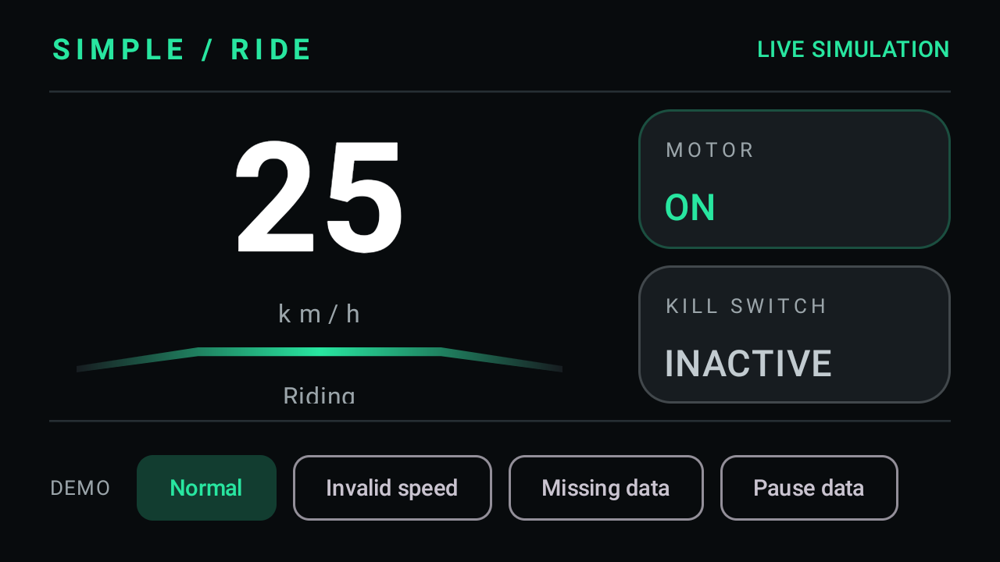
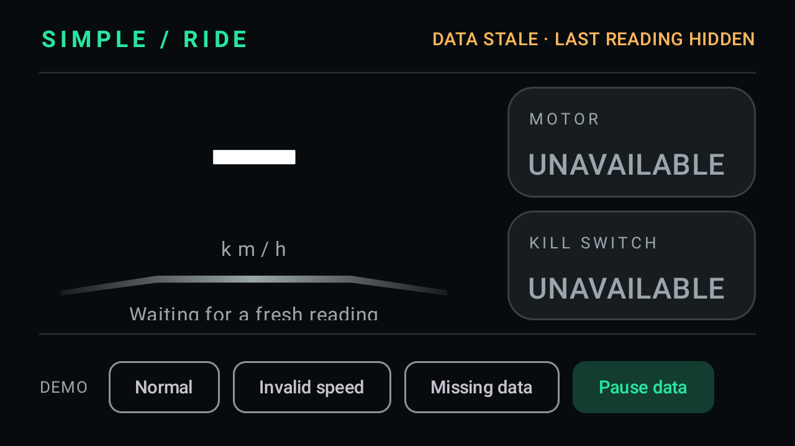

# Ride Dashboard

A landscape Android dashboard driven by simulated vehicle readings. Speed is the main focus, with separate motor and kill-switch indicators.

This project was created with AI assistance. The assignment brief prohibits AI tools for completion; obtain the evaluator's permission before using it as a submission. Do not represent this work as unaided.

## Build and run

Requirements:

- Android Studio with a compatible JDK (17 or 21).
- Android SDK Platform 35 and the SDK build tools requested by Gradle.
- An Android emulator running API 26 or newer.

Open this folder in Android Studio, let Gradle sync, select an emulator and run `app`. The activity requests landscape orientation. No network permission, hardware connection or backend is needed by the app.

From PowerShell on Windows:

```powershell
.\gradlew.bat assembleDebug
.\gradlew.bat testDebugUnitTest
.\gradlew.bat lintDebug
.\gradlew.bat connectedDebugAndroidTest
```

On macOS/Linux, use `sh ./gradlew` with the same task names.
The connected test task requires a booted emulator or connected Android device.

The debug APK is written to `app/build/outputs/apk/debug/app-debug.apk`. Unit-test reports are in `app/build/reports/tests/testDebugUnitTest/index.html`.

## Data flow

```text
SimulatedVehicleDataSource (Flow<VehicleReading>)
    -> DashboardViewModel + DashboardStateMapper
    -> StateFlow<DashboardUiState>
    -> lifecycle-aware collection in MainActivity
    -> DashboardScreen
```

- `DashboardApplication` owns the simulator so an activity recreation does not connect the controls to a different source.
- `VehicleDataSource` is the small contract shared by the simulator and test fake.
- The simulator emits once per second. It has no dependency on Compose or Android.
- The ViewModel owns one collection and a freshness check. Its jobs stop when it is cleared.
- The mapper validates readings without inventing relationships between independent vehicle signals.
- Compose renders the supplied state. It does not schedule vehicle updates.

The factory is defined at the activity's dependency boundary; a DI framework and additional Gradle modules are unnecessary here.

## Simulation

Normal mode repeats this sequence at one-second intervals:

| Scenario | Speed (km/h) | Motor | Kill switch |
| --- | ---: | --- | --- |
| Parked | 0 | OFF | Inactive |
| Ready | 0 | ON | Inactive |
| Riding | 25 | ON | Inactive |
| Accelerating | 50 | ON | Inactive |
| Motor disabled | 0 | OFF | Active |
| Coasting | 12 | OFF | Inactive |

The first reading is emitted immediately. Coasting is an additional scenario demonstrating that motor OFF does not imply zero speed.

Use the bottom controls to explore edge cases:

- **Invalid speed:** emits a negative speed while keeping valid motor and kill-switch signals.
- **Missing data:** emits unavailable values for all three signals.
- **Pause data:** stops emissions. After three seconds, the display marks the reading stale and hides vehicle values.
- **Normal:** resumes the normal sequence from its next scenario, within one second. It also recovers from the simulated invalid/missing/paused conditions.

These controls configure the simulator; they do not represent vehicle controls.

## Edge-case policy

- Missing speed is displayed as `—`. Missing Boolean signals are displayed as `UNAVAILABLE`, never as OFF or Inactive.
- Negative, non-finite or unrepresentable speeds are invalid. A bad speed does not discard other valid signals.
- Valid speed is rounded to a whole km/h. No arbitrary maximum vehicle speed is imposed.
- Until the first reading arrives, the screen shows a waiting state.
- Freshness uses monotonic elapsed time, not wall-clock time, with a three-second threshold checked every 250 ms.
- Stale and failed-source states hide the last values to avoid suggesting that old data is current. A subsequent reading restores the live state.
- A thrown source exception becomes an error state. There is no automatic retry for a permanently failed source; relaunching recreates the collection. The demo source does not normally throw.
- The ViewModel keeps its simulation running while its activity exists in the background. UI collection is lifecycle-aware. Process death restarts the simulation.

## Tests

The JVM tests use virtual coroutine time, so they do not wait for real one-second intervals.

- `DashboardStateMapperTest`: invalid speed, missing signals, and coasting with motor OFF.
- `DashboardViewModelTest`: scenario propagation, initial waiting, stale timeout and recovery, and a thrown source error.
- `SimulatorTest`: emission sequence/timing and pause/resume.
- `DashboardRunTest` (on-device): all six live scenarios, visible speed/motor/kill-switch values, invalid speed, missing signals, stale data and recovery. It saves ten real device screenshots in the app's external files directory under `verification/`.

## Design and scope

The design follows the reference's dark landscape layout, central speed reading, green accents and peripheral status indicators. The motor status remains separate from the kill switch, whose location is not specified in the reference.

The curved strip is decorative; it indicates movement and is not a calibrated analogue gauge. Alerts, maps, phone pairing, battery/range estimates, ride modes and 3D effects from the production reference are not implemented. The app does not pretend to have live values for these optional features.

UI copy is currently English-only. The dashboard was verified on an Android 11 emulator in landscape at 1280 × 720 and 420 dpi. Other Android versions and physical devices have not been tested. Compact displays use smaller status panels and omit optional descriptive text so required signals remain visible. System bars are hidden and can be revealed with a swipe.

## Verification recorded on 7 November 2026

- Debug APK: built successfully.
- Unit tests: 9 passed, 0 failures or errors.
- Android lint: completed with 0 errors and 12 warnings. These concern newer dependency/target SDK versions, fixed landscape orientation, backup configuration and the missing launcher icon. The landscape restriction is intentional for this assignment.
- Android 11 on-device verification: 1 test passed, covering six live scenarios and four edge/recovery states, with ten screenshots captured and visually inspected.
- The first emulator run exposed clipping on compact displays. The layout now sizes the speed reading from the available body height and uses compact status panels. The on-device checks assert visibility of the required values.
- A 12.56-second live screen recording was captured, and the emulator crash log had no entries.





On this Windows build host, Java needed a short Unix-domain socket temporary directory to start Gradle. If you encounter `Unable to establish loopback connection`, point the JVM property `jdk.net.unixdomain.tmpdir` at an existing short writable directory using `JAVA_TOOL_OPTIONS`, then retry the build. This is a host workaround, not an app requirement.

## Quick manual check

1. Launch on a landscape emulator and observe two complete six-second cycles.
2. Confirm speed, motor and kill-switch values match the table above.
3. Select Invalid speed; confirm only speed becomes unavailable.
4. Select Missing data; confirm all signals become unavailable.
5. Select Normal, then Pause data; confirm the stale warning after three seconds.
6. Select Normal again; confirm fresh readings restore the display.
7. Background and reopen the app; confirm the screen catches up with the current state.
8. Check that the layout remains readable without clipped labels on the chosen emulator.
